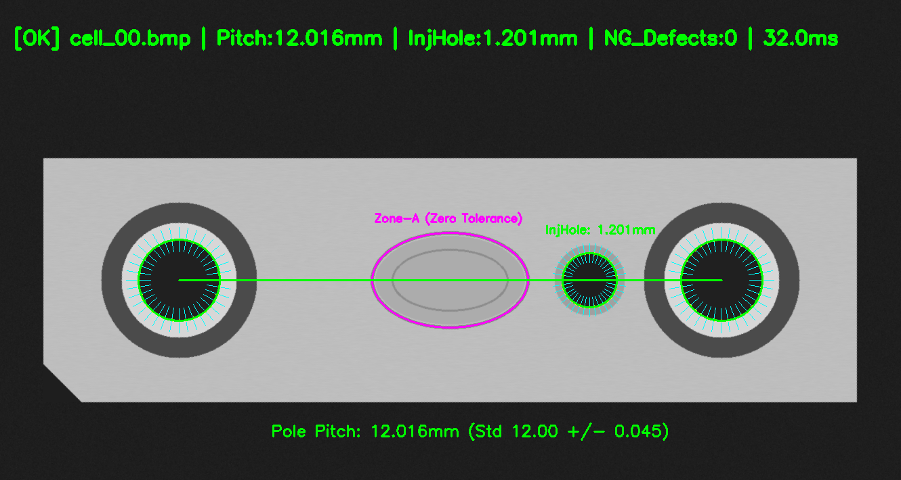
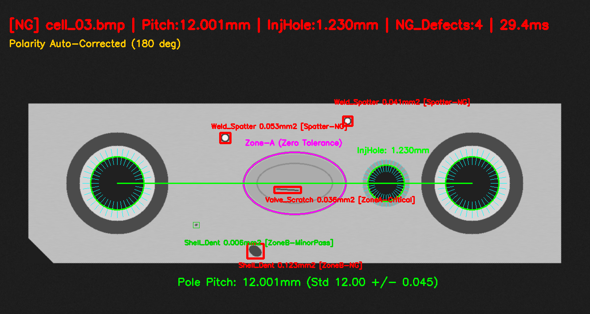

# 方形动力锂电池顶盖复合视觉检测系统 (Lithium Battery Top-Cover Hybrid Vision Inspection)

一套面向新能源动力电池产线（顶盖入壳前/封口焊后工位）的**工业级“亚像素几何量测 + YOLO 表面微缺陷 + A/B 分区防过杀 SIP”复合视觉检测工程**。

该项目打通了 **Python (OpenCV/YOLO ONNX) → MVTec Halcon → 海康 VisionMaster (VM) → 康耐视 VisionPro (VP) → C# 上位机联合部署** 的完整工业技术链路，支持在无硬件加密狗、未安装商业视觉软件的个人电脑上直接运行完整检测管线与暗色工业 HMI 上位机。

---

## 核心工业痛点与技术亮点

1. **多基准亚像素卡尺量测（定量检测）：**
   - 复刻 Halcon `Metrology` 与海康 VM【圆查找】底层数学原理，沿圆周发射 36 把一维径向卡尺，结合**高斯平滑 + 一阶正向梯度极值 + 三点抛物线亚像素插值 + 最小二乘圆拟合**。
   - 同步测量**正负极柱中心距（Pitch，影响 Busbar 激光焊接精度）**与**注液孔内径**，实测重复精度优于 0.1 像素。
2. **极性防呆与刚性摆正：**
   - 自动识别顶盖左下角极性防呆倒角，对 180° 装反来料自动纠正极性并输出报警标志。
3. **锂电 A/B 分区差异化判废（Zone-Based SIP 防过杀）：**
   - **Zone-A（中央防爆阀禁区）：** 铝箔极薄，实行**零容忍**，凡是 YOLO 检出并落入防爆阀椭圆掩膜内的划伤或焊渣 100% 判 NG。
   - **Zone-B（普通铝壳平面）：** 结合检测框内局部形态学分割计算缺陷真实物理面积（mm²），自动放行小于 `0.040 mm²` 的无害微擦痕，严控产线过杀率。
4. **工业级工程结构与开箱即用 HMI：**
   - 工艺公差解耦至 `config/sip_config.json`，支持在 HMI 界面在线修改公差并即时重判。
   - 附带完整 **Halcon `.hdev` 脚本**、**海康 VM / 康耐视 VP 移植指南** 以及 **C# + HalconDotNet + ONNX Runtime（含完整 YOLOv8/v11 Tensor 解析与 NMS）** 产线部署模板。

---

## 视觉检测效果预览

| 良品 OK（亚像素三圆卡尺 + 极柱间距测量） | 不良 NG（防爆阀 A 区零容忍 + B 区面积复判） |
| :---: | :---: |
|  |  |

---

## 工程目录结构

```text
LithiumBattery-HybridVision-Inspection/
├── config/
│   └── sip_config.json                     # 锂电工位标定当量、尺寸公差与 A/B 分区 SIP 配方
├── 01_DataGenerator/
│   └── generate_lithium_battery_data.py    # 2048x2048 产线原图与 640x640 YOLO 缺陷数据集生成器
├── 02_CoreAlgorithm/
│   ├── battery_inspector.py                # 核心混合检测引擎 (摆正 + 亚像素卡尺 + YOLO + SIP)
│   └── batch_inspect.py                    # 批量产线节拍测试与 CSV 良率报表导出
├── 03_YOLO_Workspace/
│   └── train_and_export.py                 # 工业定制化 YOLOv8/v11 训练与静态 ONNX 导出脚本
├── 04_Halcon_VM_VP_Scripts/
│   ├── 01_create_battery_model.hdev        # Halcon 离线形状模板注册脚本
│   ├── 02_online_battery_inspect.hdev      # Halcon 在线三圆测量与 A/B 分区交集判废脚本
│   └── VM_VP_Migration_Guide.md            # 海康 VisionMaster 与康耐视 VisionPro 移植对照手册
├── 05_HMI_DesktopApp/
│   ├── hmi_app.py                          # 工业暗色视觉上位机桌面软件 (Tkinter + OpenCV)
│   └── CSharp_HostApp_Template/
│       └── HybridBatteryInspector.cs       # C# (.NET) + HalconDotNet + ONNX Runtime 产线部署核心类
├── docs/sample_results/                    # 实测 HMI 效果图
├── models/                                 # 存放导出的 best_defect.onnx 与 .shm 模板
└── requirements.txt
```

---

## 快速上手 (3 分钟本地跑通)

### 1. 安装依赖

```bash
pip install -r requirements.txt
```

### 2. 生成锂电顶盖高保真仿真原图与 YOLO 数据集

```bash
python 01_DataGenerator/generate_lithium_battery_data.py
```

### 3. 启动工业视觉上位机 HMI（无需安装 Halcon/VM 即可直接运行）

```bash
python 05_HMI_DesktopApp/hmi_app.py
```

> 支持单次软触发、模拟 PLC 连续触发播放、实时良率看板以及在线修改 SIP 工艺公差。

### 4. 批量测试并导出产线 CSV 报表

```bash
python 02_CoreAlgorithm/batch_inspect.py
```

### 5. 训练专属锂电缺陷 YOLO 模型并导出 ONNX（可选）

```bash
python 03_YOLO_Workspace/train_and_export.py
```

导出的 `models/best_defect.onnx` 会被 `battery_inspector.py` 与 `hmi_app.py` 自动识别加载，从传统回退模式无缝切换至 **YOLO + 亚像素卡尺混合模式**。

---

## 商业视觉软件对接 (Halcon / 海康 VM / 康耐视 VP)

详细算子映射与拖拽连线教程请查阅：[04_Halcon_VM_VP_Scripts/VM_VP_Migration_Guide.md](04_Halcon_VM_VP_Scripts/VM_VP_Migration_Guide.md)。
